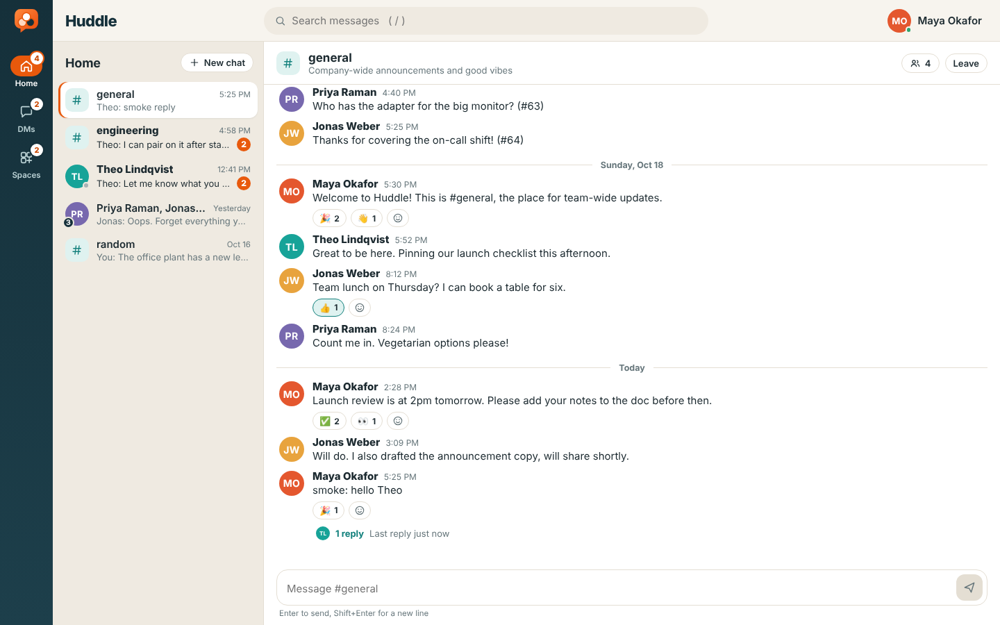
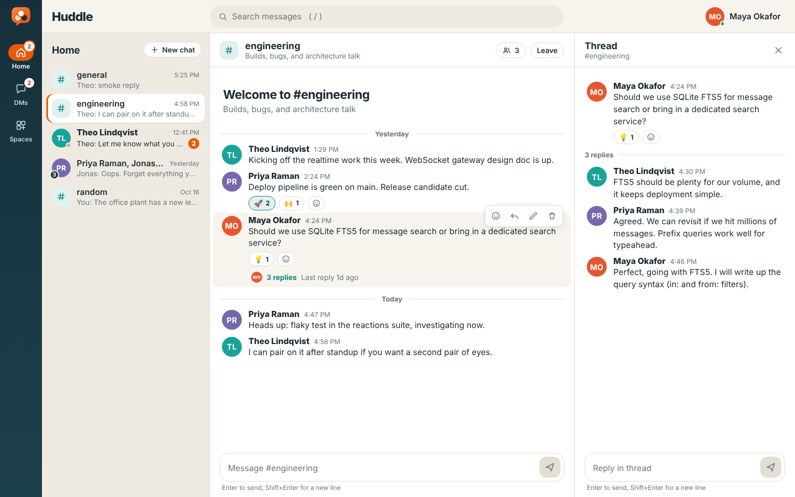

# Huddle

A small team chat app: channels ("spaces"), 1:1 and group DMs, threads, emoji reactions, realtime updates and full-text search. Original UI and branding; not affiliated with any other chat product.

**Stack:** TypeScript, Fastify 5, SQLite (better-sqlite3, FTS5), `@fastify/websocket`, React 18 + Vite. npm workspaces: `server/` and `web/`.




## Setup and run

Requires Node 20+ (developed on 22).

```bash
npm install          # installs both workspaces
npm run build        # compiles server (tsc) and web (vite) -> server/dist, web/dist
npm start            # http://localhost:3000 (serves the API, WebSocket and built UI)
```

Development with hot reload (API on :3000, Vite on :5173 proxying `/api` and `/ws`):

```bash
npm run dev
```

Tests (vitest, server only):

```bash
npm test
```

Environment variables: `PORT` (3000), `HOST` (0.0.0.0), `DB_PATH` (`server/data/huddle.db`), `STATIC_DIR` (`web/dist`), `SEED=0` to skip demo data. The database is created on first start and seeded with 4 demo users (Maya, Theo, Priya, Jonas), `#general`, `#random`, `#engineering`, a thread, reactions, one DM and one group DM.

## Architecture

```
server/src
  db.ts       schema, FTS5 index + triggers, migrations (PRAGMA user_version)
  store.ts    all SQL (parameterized only): users, conversations, messages, reactions, search
  search.ts   query parser: free text -> quoted FTS5 tokens, plus in: / from: filters
  routes.ts   REST routes with JSON-schema validation and membership checks
  ws.ts       /ws endpoint: auth, presence, typing, heartbeat
  hub.ts      socket registry; fan-out to conversation members (membership read at send time)
  app.ts      Fastify wiring, error mapping, security headers, static hosting
  seed.ts     demo data
web/src
  store.tsx   reducer + actions + realtime event handling + resync on reconnect
  socket.ts   WebSocket with exponential backoff + jitter
  components/ Rail, Sidebar, ConversationView, MessageItem, ThreadPanel, SearchPanel, Modals, ...
```

Design notes:

- **Conversations** are one table with `kind = 'channel' | 'dm'`. A DM is keyed by its sorted member-id set (`dm_key`, unique), so 1:1 and group DMs are find-or-create.
- **Threads** are messages with `parent_id` (one level; replies cannot be nested). Reply count and last reply are computed on read, so they are always consistent.
- **Deletes** are soft (body blanked, reactions removed, removed from the FTS index) so threads keep their structure.
- **Unread** = top-level messages from other users newer than the member's `last_read_id`. Thread replies do not add to the badge. Marking read clamps to the newest real message id.
- **Search** uses an external-content FTS5 table kept in sync by triggers. User text is tokenized and each token is quoted, so FTS operators typed by users are literal. Results are joined against `members`, so only conversations you belong to are searched. Snippets use control-character markers, rendered as `<mark>` through React nodes.
- **Realtime** events are sent to current members of the conversation. On reconnect the client refetches conversations, the open conversation's latest page (merged by id, or replaced if there is a gap), and the open thread.
- **Safety:** every route has a JSON schema (`additionalProperties: false`), SQL is parameterized, React renders text only (no `dangerouslySetInnerHTML`; links are limited to http/https), a CSP and basic security headers are set, and every conversation/message read or write checks membership.

## Auth-lite (prototype only)

`POST /api/users {name}` finds or creates a user by name and returns `{user, token}`; the token **is the user id**. Send it as `Authorization: Bearer <token>` (or `x-user-id`); the WebSocket takes `?token=`. There are no passwords, so anyone who knows an id can act as that user. Do not expose this to the internet as is.

## REST API

All routes except the first three need the bearer token. Errors are `{error: string}` with 400 (validation), 401, 403 (not a member / not the author), 404, 409.

| Method | Path | Notes |
| --- | --- | --- |
| GET | `/api/health` | liveness |
| GET | `/api/demo-users` | users for the login screen |
| POST | `/api/users` | `{name}` find-or-create, 201 or 200 |
| GET | `/api/me`, `/api/users` | current user; all users with `online` |
| GET | `/api/channels` | all public channels with `joined`, `memberCount` |
| POST | `/api/channels` | `{name, topic?}` name `[a-z0-9_-]{1,40}`; 409 if taken |
| POST | `/api/channels/:id/join`, `/leave` | idempotent |
| GET | `/api/conversations` | your conversations with `unread`, `lastMessage`, `memberIds` |
| GET | `/api/conversations/:id` | one summary (member only) |
| POST | `/api/dms` | `{userIds: [...]}` 1 to 8 others; find-or-create (201/200) |
| GET | `/api/conversations/:id/messages` | top-level messages; `?before=<id>`, `?after=<id>`, `?around=<id>`, `?limit=1..100`; returns `{messages, hasMore, hasNewer}` oldest first |
| POST | `/api/conversations/:id/messages` | `{body, parentId?}` (1..4000 chars) |
| POST | `/api/conversations/:id/read` | `{messageId?}` mark read |
| GET | `/api/messages/:id/thread` | `{parent, replies}` |
| PATCH / DELETE | `/api/messages/:id` | author only |
| POST | `/api/messages/:id/reactions` | `{emoji}` toggles; returns grouped `reactions` |
| DELETE | `/api/messages/:id/reactions/:emoji` | explicit remove |
| GET | `/api/search?q=&limit=` | e.g. `deploy in:engineering from:maya`; `in:dm` for DMs |

Message shape: `{id, conversationId, userId, parentId, body, createdAt, editedAt, deleted, replyCount, lastReplyAt, lastReplyUserId, reactions: [{emoji, count, userIds}]}`.

## WebSocket events

Connect to `/ws?token=<user id>`. Server to client (JSON, `type` field):

| type | payload | sent to |
| --- | --- | --- |
| `hello` | `userId, online[]` | the new socket |
| `presence` | `userId, online` | everyone connected |
| `message.new` | `message` (replies have `parentId`) | conversation members |
| `message.updated` / `message.deleted` | `message` | conversation members |
| `thread.updated` | `parentId, replyCount, lastReplyAt, lastReplyUserId` | conversation members |
| `reaction.updated` | `messageId, parentId, reactions[]` | conversation members |
| `typing` | `conversationId, parentId, userId` | other members |
| `conversation.new` | `conversation` (per-user summary) | the member(s) concerned |
| `channel.created` | `channel` | everyone connected |
| `member.joined` / `member.left` | `conversationId, userId` | conversation members |
| `read` | `conversationId, lastReadId` | your other tabs |

Client to server: `{type:'typing', conversationId, parentId?}` and `{type:'ping'}`. The server pings every 30 s and drops dead sockets.

## Known gaps

- No real authentication, rate limiting, or file uploads; no private channels, invites, or admin roles.
- Search covers conversations you are a member of; there is no "preview before joining".
- Thread replies do not count toward unread badges; no @mentions or notifications.
- Single-process design: presence and fan-out live in memory, so it does not scale horizontally as is.
- Server tests cover the REST API and WebSocket delivery; the React UI has no automated tests (it was checked manually with Playwright).
